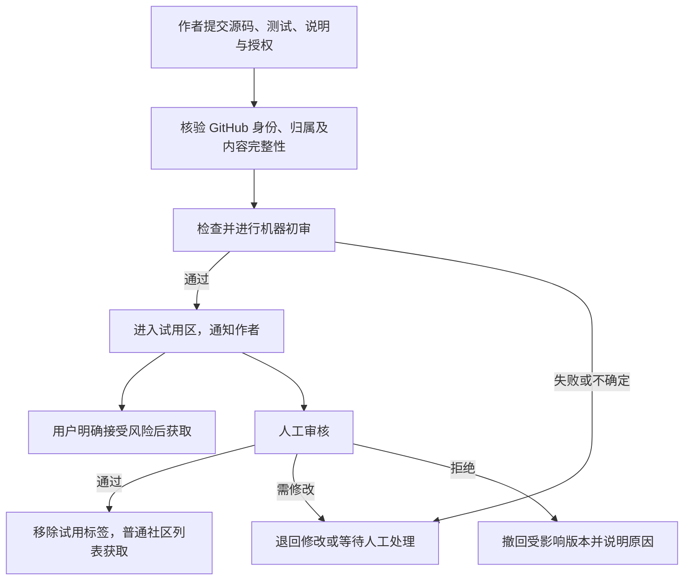

# 社区插件准入、审核与风险提示

本政策规定投稿与使用边界。审核服务已经启用，客户端作者展示、试用区、风险确认和撤回提醒仍待接入；不把目标流程写成当前客户端已具备的保护，不向现有普通目录混入仅机器初审内容。

## 投稿流程

首次机器反馈目标为接收后 5 分钟，人工审核目标为初审通过后 24 小时；超时保留待审／试用状态并通知延期，不自动通过。合并源码、机器初审、人工审核与实际上架是不同结果。机器结论不替代必要检查；不完整、异常或不确定的内容不自动放行。

## 作者、版本与归属

作者显示名允许自填；社区插件同时保留经验证的 GitHub 数字用户 ID，不能用同名、头像或自填字段冒充他人。首次接纳时绑定插件稳定 ID 与所有者，后续更新核对所有者或授权维护者。身份转移须经可信确认并留记录，不能编辑作者字段完成。

官方来源由维护者可信记录认定；官方插件可显示官方标识而不公开数字 ID，仍记录真实提交者。人工已审社区插件不会变成官方插件。代投稿、合法分支及维护接手分别注明原作者、维护者、来源与许可证；账号身份不等于原创证明，也不保证账号未被盗。

审核绑定稳定 ID、版本、最终包 SHA-256 与对应源码提交。新版本重新审核；已发布同版本不覆盖为不同内容。未经确认不将人工已审版本更新为试用版本，也不自动启用已停用插件。审核范围、已知限制和重要风险变化如实展示。

## 状态与用户选择

待审、异常、拒绝及撤回版本不可安装。仅机器初审版本默认隐藏；用户主动开启试用内容后，每次首次安装须确认具体作者、版本与用途。人工通过后移除试用标签，但持续标注社区来源。安装、更新、详情、搜索和前置链遵守同一规则。

关闭试用显示选项恢复隐藏，不卸载、删除配置或自动启停已有插件。撤回明确受影响版本及原因，并提供停用、卸载和问题反馈途径；不声称当前已实现远程停用或所有客户端提醒。

## 内容调整授权

“允许维护者进行有限内容调整”默认关闭。作者明确接受后，可在授权范围内调整不合适的名称、文案、图片、外链或独立可选内容。涉及主要用途、数据上传、付费消耗、许可证或署名的变化另需确认。没有授权时退回作者修改。

调整保留原始投稿、差异与原作者署名，标注维护者调整及实际影响；最终内容重新检查审核，不沿用修改前结论。目前记录授权，自动内容调整功能尚未完成。

## 风险披露与必要文案

卡片显示插件名、作者、版本、来源／审核状态和简介；详情说明读取的数据、联网目标及发送字段、自动操作、资源消耗、源码与许可证。声明用途不代表权限已被隔离。不得用“安全认证”描述机器或人工审核。

> **未经人工审核的社区插件**
>
> 这些插件仅通过机器初审，机器未发现明显风险不代表插件安全。当前插件运行环境没有真正的安全沙箱，插件代码可能读取游戏页面可访问的信息、向外部发送数据或执行游戏操作，可能造成隐私泄露、道具或货币损失，以及游戏账号受限等后果。是否违反游戏规则或产生账号处罚取决于游戏方，工具箱无法保证不受影响。请仅安装你信任的作者和理解其用途的插件。你可以随时关闭此显示选项。

开启时提供“接受风险并显示”及“取消”；不得预选同意。安装／更新另列明具体作者、数字身份、版本、审核时间、数据用途与消耗，使用“接受风险并安装／更新”和“取消”，不以模糊的继续代替。人工已审提示“人工审核仅覆盖所列版本与范围，不保证绝对安全”；官方插件同样披露实际风险。

## 第三方处理与发行范围

自动投稿前明确同意所选第三方处理源码、必要依赖、测试、说明及最终包。不同意者可走人工途径，不自动发送；不得夹带登录信息、用户游戏数据或无关私有代码。具体材料见[投稿说明](review-server.md)。

Full 只计划固定随附少量最通用的官方插件，社区插件不随附。白名单固定后不轻易修改，上架和审核通过不自动改变该名单；具体实现状态见[发行版说明](distributions.md)。
